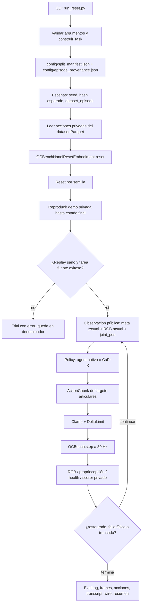
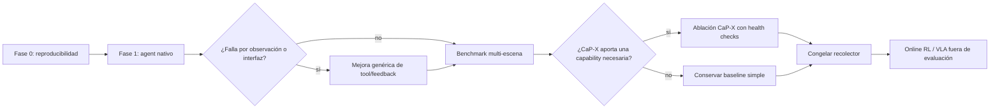

# Flujo de Reset Agéntico: Inspect Robots + OCBench Hanoi

> Documento de arquitectura y operación. Describe el comportamiento actual,
> sus contratos y sus límites; no propone que la política reciba estado
> privilegiado ni trayectorias demostrativas.

## 1. Objetivo, alcance y criterio de éxito

El sistema evalúa un agente que debe **restaurar** una escena de OCBench a una
meta definida. El modo predeterminado es `text`: no entrega una imagen objetivo.
En Hanoi, el agente empieza desde el estado final de un episodio exitoso, con la
torre fuera de su peg original, y recibe la definición completa de la meta:
reconstruir una torre legal de tres discos en el peg central. El modo
`reference` queda como ablación explícita y no se mezcla con los resultados
textuales.

Esta fase es un experimento de control cerrado, no de aprendizaje:

- No hay VLA ni actualización online de pesos.
- La demostración se usa de manera privada para preparar el estado inicial del
  reset; la política no ve sus acciones, poses de objetos, recompensa ni señal
  de éxito.
- El éxito lo determina el simulador: torre legal sobre el peg de origen,
  gripper abierto y estabilidad por cinco pasos consecutivos.
- `done` sólo expresa intención de terminar; no otorga éxito.

La meta de diseño es que la misma arquitectura pueda reutilizarse en otros
resets. Por ello, ningún componente de política debe conocer coordenadas,
secuencia de movimientos o reglas codificadas específicamente para Hanoi.

### 1.1 Estado de aprendizaje: qué ocurre hoy y qué no ocurre

El término "agente" no implica que el sistema esté entrenándose mientras
evalúa. **La implementación actual no actualiza la policy entre episodios.**

En cada trial, `LLMAgentPolicy.reset(scene)` reinicia el historial de mensajes,
el contador de llamadas, el hindsight y el estado de imágenes. Durante la
inferencia el modelo recibe únicamente:

1. los pesos remotos e inmutables identificados por `--model`;
2. el prompt base, la instrucción y el contrato de herramientas;
3. la observación de ese trial (RGB actual, `joint_pos` y referencias); y
4. opcionalmente, un archivo `--prior-learnings` leído una vez al construir la
   policy.

El hindsight se guarda en el log al finalizar el trial; no se inyecta
automáticamente en el siguiente. `--prior-learnings` es memoria estática y
versionada: debe prepararse a partir de datos de desarrollo antes de una
evaluación y permanecer idéntica durante toda ella. No es aprendizaje online.

Inspect Robots proporciona un bucle agentico **entre runs**, denominado
"Retry with learning", que convierte ese hindsight en la memoria estática del
siguiente run:

```text
run N (policy fija)
  -> done/give_up pide hindsight al agente
  -> EvalLog guarda transcript, acciones, resultado y hindsight
  -> inspect-robots summarize destila un archivo Markdown de lecciones
  -> run N+1 recibe ese archivo con --prior-learnings
  -> el LLM razona con las nuevas lecciones y la observación actual
```

El comando `summarize` puede crear un digest determinista sin modelo o una
síntesis Markdown con un LLM. El resultado no se reescribe durante el rollout:
se lee una sola vez al construir la policy y su ruta/hash quedan registrados en
el EvalLog. Esto hace el aprendizaje auditable y evita que una evaluación se
autocontamine. Para una comparación válida, se cosechan lecciones en `train`,
se congela el mismo archivo para validation y no se deriva memoria de `test`.

Por tanto, el flujo correcto tiene tres niveles que no deben mezclarse:

| Nivel | Qué se actualiza | Cuándo | Puede usar validation/test |
|---|---|---|---|
| Inferencia actual | Nada; el LLM decide con su contexto del trial. | En cada rollout. | Sí, pero sin alterar prompt/herramientas durante el run. |
| Retry with learning | Archivo Markdown de `prior_learnings`, no pesos. | Entre runs; `summarize` produce y el siguiente run consume. | Sólo notas cosechadas en `train`; congelar antes de validation/test. |
| Desarrollo / entrenamiento | Prompt, herramientas o pesos de una policy entrenable. | Fuera de evaluación, usando solamente `train`. | No. |
| Evaluación | Nada. Se mide una configuración congelada. | Validation para seleccionar versión; test una vez al final. | Validation sí para selección; test sólo para el resultado final. |

Para online RL futuro, el ciclo será explícito: recolectar rollouts de
**train** -> calcular reward/resultado -> optimizar una nueva versión de la
policy -> congelar checkpoint y configuración -> evaluar en validation/test
separados. El reset agent facilita la recolección; no forma parte del gradiente
ni aprende por el hecho de haber hecho un reset.

## 2. Inventario técnico y puntos de entrada

| Función | Archivo / componente | Responsabilidad |
|---|---|---|
| Entrada CLI | `experiments/capx_hanoi/run_reset.py:main()` | Parseo de argumentos, construcción de task/policy/robot, ejecución y resumen. |
| Selección de backend | `run_reset.py:_build_policy()` | Selecciona `agent` nativo o `capx` opcional. |
| Planificación de escenas | `plugins/inspect-robots-ocbench/.../task.py:hanoi_reset_task()` | Convierte split + provenance ledger en escenas reproducibles. |
| Lectura de acciones privadas | `experiments/capx_hanoi/reset_data.py:load_episode_actions()` | Lee exclusivamente acciones de episodios requeridos del dataset LeRobot. |
| Embodiment | `plugins/inspect-robots-ocbench/.../embodiment.py:OCBenchHanoiResetEmbodiment` | Inicializa OCBench, reproduce la demo privada, expone la observación seleccionada y ejecuta el reset. |
| Agente nativo | `plugins/inspect-robots-agent/.../policy.py:LLMAgentPolicy` | Traduce observación + herramientas a decisiones LLM y chunks de acción. |
| Seguridad | `inspect_robots.approver.ChainApprover` | Aplica `ClampApprover` y `DeltaLimitApprover` antes de cada step. |
| Evaluación y evidencia | `inspect_robots.eval()` | Ejecuta trials, puntúa, persiste frames, acciones, transcript, wire capture y JSON. |

### 2.1 Parámetros de operación relevantes

| Parámetro | Obligatorio / default | Efecto |
|---|---:|---|
| `--dataset-root` | Obligatorio | Raíz LeRobot con `meta/info.json` y `data/**/*.parquet`. |
| `--model`, `--base-url` | Obligatorios | Modelo y endpoint OpenAI-compatible. |
| `--api-key-env` | `OPENAI_API_KEY` | Nombre de la variable de entorno; nunca se pasa la clave literal. |
| `--policy` | `agent` | Baseline nativo o CaP-X opcional. |
| `--wire` | `responses` | Protocolo de API para el agente nativo. |
| `--goal-mode` | `text` | Usa sólo la meta textual; `reference` añade imágenes objetivo como ablación separada. |
| `--max-llm-calls` | `64` | Horizonte de decisiones por trial, no límite monetario ni steps físicos. |
| `--images` | `always` | Entrega las cámaras actuales en cada decisión. |
| `--live-transcript` | activo | Imprime observaciones, uso, tool calls y resultados durante el rollout. |
| `--rerun`, `--rerun-port` | desactivado, `9876` | Abre el visor local en vivo y guarda un `.rrd`; requiere el extra opcional `rerun`. |
| `--split`, `--num-scenes` | `validation`, todos | `train` para producir aprendizajes; `validation` para seleccionar y `test` para el resultado final. |

## 3. Flujo actual de extremo a extremo



### 3.1 Preparación de una escena de reset

| Paso | Objetivo | Entrada | Salida | Validaciones / fallos |
|---|---|---|---|---|
| Resolver escenas | Usar únicamente episodios definidos para el split. | `config/split_manifest.json`, `config/episode_provenance.json`, `split`, `num_scenes`. | `Scene(id, instruction, metadata)`. | Split inválido, vacío, episodio ausente del ledger o `num_scenes` fuera de rango generan `ValueError`. |
| Cargar acciones | Obtener el stream privado necesario para la reproducción. | Dataset root y `dataset_episode`. | `float32[N, 7]` ordenado por `frame_index`. | Exige dataset LeRobot, 30 Hz, acción de dimensión 7, Parquet disponible, frames contiguos y valores finitos. Falta `pyarrow` produce `ImportError`. |
| Reset OCBench | Obtener mundo determinista de la semilla de escena. | `reset_seed`, entorno OCBench congelado. | Mundo, tres RGB de 224×224 y `joint_pos`. | Requiere checkout OCBench; verifica límites articulares y escala de delta del contrato. |
| Definir objetivo | Proporcionar una condición completa sin geometría privilegiada. | Instrucción del task y `--goal-mode`. | Meta textual; opcionalmente RGB objetivo en la ablación `reference`. | El modo queda registrado en Task, EvalLog y resumen. |
| Replay privado | Llegar al estado final de la demo. | Targets absolutos `[N,7]`. | Escena inicial del agente. | Rechaza health/failure, truncación, ausencia de éxito fuente o una torre que nunca abandonó el origen. |

### 3.1.1 Decisión arquitectónica: replay completo frente a "tomar el último estado"

El replay completo que existe hoy es correcto para preparar el reset. No se
reproduce para enseñar al agente ni para que imite la demostración; se
reproduce para que MuJoCo calcule el estado físico que dejó la interacción.

No es suficiente tomar la última fila visible del dataset porque contiene la
propiocepción del robot (siete joints) y las acciones, pero no un snapshot
completo de la simulación: posiciones y orientaciones de discos, velocidades,
contactos, layout dinámico de pegs y estado interno del entorno. Establecer sólo
los joints finales dejaría los objetos en la disposición del reset original, no
en el estado final de Hanoi.

La semántica actual es, por tanto:

```text
reset por seed -> aplicar toda la trayectoria privada
-> verificar que terminó en éxito fuente -> entregar ese mundo al agente reset
```

Esto garantiza que el estado inicial del agente es alcanzable por la dinámica
del simulador y que no se filtra una pose privilegiada al LLM. Su coste es
repetir miles de ticks de setup por trial; por ejemplo, el episodio 2 necesita
4,303 pasos de replay antes del primer step del agente.

La optimización correcta no es usar el último `joint_pos` del dataset. Es crear
un **cache privado y versionado de snapshots físicos**:

1. Una vez por episodio, hacer el replay completo actual.
2. Guardar estado físico suficiente para restaurar el mundo: al menos `qpos`,
   `qvel` y `dynamics_info` de Hanoi, además de metadatos de versión.
3. En cada rollout posterior, hacer reset por la misma seed y restaurar el
   snapshot dentro del embodiment; nunca entregarlo a la policy.
4. Validar cada entrada del cache contra el replay: health, predicado de éxito
   fuente, RGB/tolerancias físicas y hash de configuración.
5. Invalidar el cache si cambian commit de OCBench, MuJoCo, timestep, XML,
   dataset revision, acción de origen o contrato del embodiment.

OCBench expone `set_state(qpos, qvel, dynamics_info)` para Hanoi, por lo que
la optimización es factible, pero debe verificarse cuidadosamente: un snapshot
incompleto puede omitir contactos/caches derivados y producir una escena que
parece correcta en joints pero no es físicamente equivalente. Hasta que dicha
validación exista, el replay es el camino más fiable.

### 3.2 Bucle de decisión y control

1. `eval()` vincula la policy con el espacio de acción y observación del
   embodiment.
2. La policy recibe RGB actual de tres cámaras y siete joints; el prompt incluye
   la definición textual del estado objetivo, límites y presupuesto. Sólo el
   modo `reference` añade imágenes objetivo.
3. Con `--policy agent`, se construyen herramientas a partir del contrato del
   embodiment: `move_joints`, `done` y `give_up`. CaP-X no se importa en esta
   ruta.
4. `move_joints` convierte dimensiones nombradas en un target absoluto y lo
   interpola en un `ActionChunk`. Cada chunk se ejecuta abierto hasta completar
   sus steps, tras lo cual se observa de nuevo.
5. Antes de `OCBench.step`, `ClampApprover` restringe el target a los bounds y
   `DeltaLimitApprover` restringe cambios entre comandos. Las modificaciones se
   registran en la observación siguiente.
6. El embodiment transforma el target absoluto en un delta normalizado con
   respecto al joint medido y ejecuta un tick de OCBench. El tick de control es
   `1/30 s`; la física interna es `1/600 s`.
7. El scorer privado termina solamente por éxito de reset, fallo físico o
   truncación. Cinco ticks consecutivos de torre restaurada y gripper abierto
   son necesarios para éxito.

### 3.3 Artefactos de salida

| Artefacto | Contenido y finalidad |
|---|---|
| `summary-<split>-<timestamp>.json` | Resumen de estado, éxito, pasos, errores, backend y configuración. |
| `ocbench-...json` | EvalLog completo: samples, scorer, timings y metadata. |
| `frames/<run-id>/` | Frames RGB por step y cámara; permite reconstruir video. |
| `actions/<run-id>/*.jsonl` | Targets aprobados y ejecutados, etiquetados por tick. |
| `transcripts/<run-id>/*.jsonl` | Conversación sanitizada, tool calls y feedback. |
| `wire/<run-id>/` | Solicitudes/respuestas del proveedor y blobs de imágenes para depuración. |

`evaluation_status: "success"` significa que el proceso de evaluación terminó
sin error de infraestructura. No equivale a `successful_scenes > 0`.

## 4. Evidencia del primer rollout nativo

El trial `validation-reset-002` se ejecutó con `gpt-6-astra`, `responses`,
esfuerzo `low`, una escena y `max_llm_calls=8`.

| Métrica | Resultado | Lectura |
|---|---:|---|
| Estado de evaluación | `success` | No hubo error de entorno, policy ni API. |
| Escenas exitosas | `0 / 1` | La torre no regresó al peg central. |
| Steps de control | `16` | Corresponden a 0.53 s de tiempo simulado a 30 Hz. |
| Llamadas LLM | `8` | Siete movimientos y una finalización `give_up`. |
| Guardrails | 2 `delta_clamped` | La seguridad intervino en reversas de movimiento. |

La suma exacta de steps fue `1 + 3 + 1 + 2 + 1 + 4 + 3 + 1 = 16`; el último
step corresponde al chunk de parada de `give_up`. El agente levantó el disco
pequeño, observó que los otros discos permanecían en el peg derecho, lo
devolvió y terminó por falta de presupuesto.

El visor codifica una imagen por step a 30 fps. Por eso el video dura cerca de
0.53 s y parece rápido. Es el tiempo del **simulador OCBench**, no una
certificación de velocidad para un UR5e físico: el deployment de hardware
requerirá un adapter de controlador, límites de velocidad/aceleración/jerk y
feedback físico propios.

## 5. Manejo de errores y condiciones de terminación

| Capa | Condición | Comportamiento actual | Riesgo operativo |
|---|---|---|---|
| Credenciales | `OPENAI_API_KEY` no está exportada. | El proveedor responde 401; el trial queda como error. | Configuración de shell inconsistente. |
| Runtime | `ocbench` o `pyarrow` no está instalado en el intérprete. | `ImportError` con mensaje dirigido; `doctor` lista la remediación. | Ejecutar `uv sync --all-packages --extra ocbench --python 3.12` para crear el `.venv` reproducible. |
| Dataset | Root incompleto, 30 Hz incorrectos, acción no `[7]`, Parquet inválido. | `ValueError` / `ImportError` antes de evaluar. | Evita ejecutar con un dataset incompatible. |
| Setup replay | Health malo, truncación o demo sin éxito fuente. | `ValueError`; no se expone una escena inválida al agente. | Puede reducir cobertura si la fuente se degrada. |
| Tool call | Target inválido/fuera de rango o formato erróneo. | Error estructurado devuelto al LLM; puede corregirse. | Reintentos consumen presupuesto. |
| Safety | Target fuera de bounds o delta excesivo. | Clamp / delta-limit; modificación queda registrada. | El LLM puede razonar sobre un target que no se ejecutó exactamente. |
| Física | `failure` o `healthy=false`. | Trial termina con fallo. | Requiere clasificar si fue percepción, plan, control o entorno. |
| Éxito | Torre + gripper no permanecen estables cinco ticks. | No hay éxito aunque el agente llame `done`. | Evita falsos positivos. |

El `finally` del runner cierra el robot y, si la policy lo ofrece, su cliente.
`fail_on_error=False` permite registrar errores por escena y conservarlos en
la métrica global, en lugar de abortar toda la evaluación.

## 6. Evaluación frente a Code as Policies y trabajos afines

### 6.1 Qué recomiendan los enfoques de mejor desempeño

| Referencia | Patrón relevante | Implicación para este proyecto |
|---|---|---|
| Code as Policies | El LLM compone APIs de percepción/control en programas con condiciones y bucles; usa ejemplos few-shot y generación jerárquica. | Separar planificación de alto nivel de una interfaz de habilidades estable. El baseline de function calls no es todavía CaP estricto. |
| Inner Monologue | El feedback de escena, éxito y efecto de acciones entra de nuevo al planificador para replantear. | Cada subobjetivo de reset debe tener evidencia de progreso y una rama de recuperación. |
| VoxPoser | El LLM especifica affordances/restricciones; planificación densa y MPC ejecutan/replanifican. | La política no debería inferir cinemática precisa sólo desde RGB + joints. Requiere una capa de grounding/control fiable. |
| CaP-X | Evalúa agentes que escriben código sobre primitives de percepción/control con distintos niveles de abstracción e interacción. | Debe ser una ablación posterior, activada únicamente cuando una carencia concreta del baseline lo justifique. |

Fuentes primarias: [Code as Policies](https://arxiv.org/abs/2209.07753),
[Inner Monologue](https://arxiv.org/abs/2207.05608),
[VoxPoser](https://arxiv.org/abs/2307.05973) y
[CaP-X](https://github.com/capgym/cap-x).

### 6.2 Patrón de prompt y ejecución recomendado

El prompt debe describir un ciclo reutilizable, no una receta de Hanoi:

```text
1. Observa el estado actual y la referencia.
2. Identifica una discrepancia concreta y un único subobjetivo verificable.
3. Elige la habilidad más segura; declara qué señal confirmará progreso.
4. Ejecuta un movimiento acotado.
5. Observa de nuevo; confirma, corrige o activa recuperación.
6. Declara finalización sólo tras evidencia visual y de estabilidad.
```

Los ejemplos few-shot futuros deben enseñar semántica de herramientas,
verificación y recuperación. No deben contener joints, pegs o la solución de
Hanoi, porque eso invalidaría la generalización a otros resets.

## 7. Mejoras Propuestas y Optimizaciones

> Estas mejoras son recomendaciones de arquitectura. No están implementadas en
> este cambio documental y deben evaluarse en fases con las mismas escenas.

### Prioridad 0 — Validar el contrato de meta textual

**Problema.** Una meta textual incompleta puede hacer imposible distinguir el
estado final correcto. En Hanoi la meta es inequívoca porque nombra peg, orden,
liberación y estabilidad; esta propiedad no se puede asumir para otros resets.

**Propuesta.** Exigir que cada task declare una condición textual verificable y
seleccionar `reference` sólo cuando texto y estado estructurado no determinen una
configuración única. Si se activa `reference`, sus imágenes deben persistir o
reinyectarse de forma explícita durante el rollout.

**Criterio de aceptación.** El EvalLog identifica `goal_mode`; texto y referencia
se reportan por separado y el scorer privado aplica la misma condición física.

### Prioridad 1 — Separar smoke test de evaluación de capacidad

**Problema.** El ensayo histórico de ocho llamadas sólo probó integración y no
permitió completar una secuencia larga de pick/place con joints. El runner usa
ahora 64 llamadas como horizonte predeterminado, pero aún falta formalizar
perfiles comparables.

**Propuesta.** Definir perfiles de presupuesto, por ejemplo `smoke`,
`diagnostic` y `benchmark`, versionados junto al manifest. Medir llamadas,
steps, coste y éxito para cada perfil, sin mezclar resultados.

**Criterio de aceptación.** El reporte identifica explícitamente el perfil y
permite comparar únicamente trials con igual escena, modelo y presupuesto.

### Prioridad 2 — Elevar la abstracción de control de forma genérica

**Problema.** `move_joints` deja al LLM resolver geometría, cinemática,
trayectorias y agarre desde RGB y siete ángulos. Esto es el cuello de botella
principal observado; no es una deficiencia específica de Hanoi.

**Propuesta.** Diseñar primitivas reutilizables y verificables, respaldadas por
un controlador/IK con health-check: observar, mover efector a pose cartesiana,
abrir/cerrar, agarrar/liberar y verificar progreso. Cada primitive debe
declarar precondiciones, bounds, timeout, resultado medido y motivo de rechazo.

**Criterio de aceptación.** La nueva interfaz mejora éxito y/o steps frente al
baseline nativo en las mismas escenas, sin exponer poses privilegiadas ni
codificar objetos/pegs.

### Prioridad 3 — Recuperación explícita y logging estructurado

**Problema.** El transcript narra intención, pero el pipeline no clasifica de
forma estructurada si falló percepción, agarre, control, límite de seguridad o
presupuesto.

**Propuesta.** Añadir códigos de outcome por subobjetivo, un snapshot antes y
después de cada habilidad, y una política de retry con máximo configurable.
Registrar target pedido, target aprobado, target medido y residual.

**Criterio de aceptación.** Cada trial fallido puede agruparse sin revisión
manual de video; ningún reintento ciego excede su límite.

### Prioridad 4 — CaP-X como ablación controlada

**Problema.** Servicios de segmentación, grasping e IK añaden complejidad,
latencia y puntos de fallo. En intentos previos, servicios no disponibles
provocaron fallos de `segment()` y `solve_ik()`.

**Propuesta.** Empezar con el conjunto mínimo de herramientas que responda a un
diagnóstico observado. Cada servicio debe tener health-check previo, timeout,
resultado tipado y fallback claro. Ejecutar una matriz de ablación contra el
baseline nativo: mismas escenas, modelo, call budget y métricas.

**Criterio de aceptación.** Una capability se conserva sólo si mejora el éxito
o la eficiencia neta y no incrementa los errores de infraestructura.

### Prioridad 5 — Preparar datos para online RL sin contaminar evaluación

**Problema.** Mezclar recolección, entrenamiento y evaluación impide atribuir
una mejora a la política.

**Propuesta.** Congelar versiones de agente/reset y almacenar transiciones
`(observación, acción aprobada, observación siguiente, outcome, versión)`.
Entrenar fuera del split de evaluación y evaluar la política actualizada en
seeds/escenas nunca usados para recolección.

**Criterio de aceptación.** Hay trazabilidad de dataset, versión de policy,
escena y separación train/eval para cada métrica publicada.

## 8. Flujo operativo recomendado por fases



| Fase | Objetivo | Entrada | Salida / puerta de decisión |
|---|---|---|---|
| 0. Reproducibilidad | Asegurar entorno, dataset, seeds y replay. | OCBench fijado, dataset y manifests. | Setup sano y estado de reset no resuelto. |
| 1. Baseline nativo | Medir sin CaP-X. | `--policy agent`, herramientas nativas. | Diagnóstico de capacidad y fallos, no sólo una tasa final. |
| 2. Interfaz genérica | Resolver el cuello de botella identificado. | Métricas y logs de Fase 1. | Mejora cuantificada sin hardcodear Hanoi. |
| 3. Ablación CaP-X | Justificar percepción/IK adicionales. | Misma matriz de evaluación. | Decisión basada en éxito, coste, latencia y fiabilidad. |
| 4. Datos/RL | Transformar rollouts en aprendizaje reproducible. | Recolector congelado y splits separados. | Política entrenada evaluada fuera de distribución de recolección. |

### 8.1 Cómo usar muchos episodios sin invalidar la evaluación

Usar varios episodios y después probar en otros es la estrategia adecuada,
pero requiere respetar el manifiesto actual: 180 episodios `train`, 22
`validation` y 23 `test`, separados por episodio y por layout reconstruido.
El runner de reset actual expone sólo `validation` y `test`; no implementa una
fase de entrenamiento sobre `train`.

El protocolo recomendado es:

```text
train: diseñar herramientas/prompt o entrenar una policy; recolectar memoria y datos
  -> validation: comparar configuraciones congeladas y seleccionar una sola
  -> freeze: fijar checkpoint, prompt, tools, cache de estado y presupuesto
  -> test: medir una vez, sin cambios ni notas derivadas de sus resultados
```

Para el objetivo final de reset tras una VLA, los finales de demostraciones
exitosas son un buen primer conjunto: representan el caso donde la tarea
productiva sí terminó y hay que devolver la escena al estado de inicio. No son
suficientes por sí solos para robustez general. Una VLA real también puede
dejar estados parciales, agarres perdidos o configuraciones no vistas. Cuando
el baseline funcione, la distribución de entrenamiento/evaluación debe añadir
de forma segura endpoints de ejecuciones parciales y perturbaciones controladas,
manteniendo los splits separados. El reset agent debe aprender/ser evaluado
sobre la distribución de estados que realmente dejará la policy productiva.

## 9. Checklist previo a cada experimento

- [ ] Se usa el `.venv` generado con `uv sync --locked --all-packages --extra ocbench`, con el commit/versiones fijados de OCBench.
- [ ] `OPENAI_API_KEY` está exportada, sin escribir secretos en comandos,
      logs ni repositorio.
- [ ] Dataset, split manifest y provenance ledger corresponden a la misma
      revisión.
- [ ] El run especifica backend, modelo, wire, esfuerzo, call budget y escenas.
- [ ] El perfil es `smoke`, `diagnostic` o `benchmark`, y no se comparan entre
      sí sin indicarlo.
- [ ] Se guardan EvalLog, frames, actions, transcript y wire capture.
- [ ] Se distingue `evaluation_status` de éxito físico de reset.
- [ ] El resultado incluye una taxonomía de fallo, no sólo éxito/fracaso.
- [ ] Ninguna mejora usa información privilegiada ni modifica la policy durante
      el split de evaluación.
